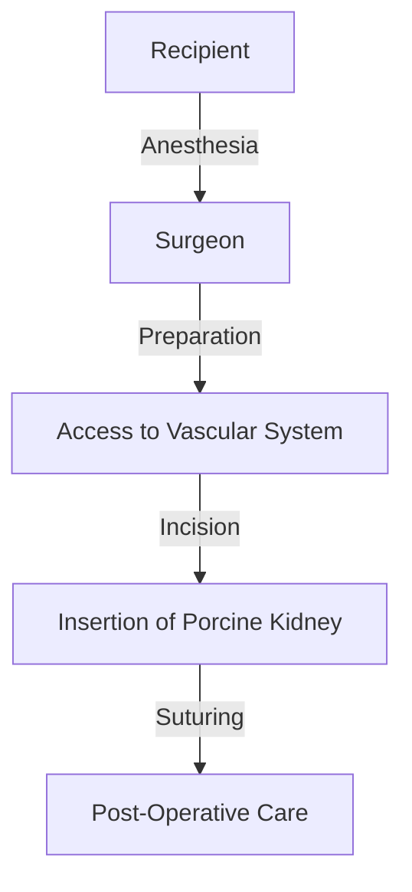

# Revolutionizing Our Understanding: Breakthroughs in Science from September 2026

## Introduction to Breakthrough Discoveries in September 2026

September 2026 witnessed several groundbreaking discoveries that are reshaping our understanding of history, medicine, and biology. Let's delve into the key findings and their implications.

### Major Findings from Ancient Coins and Historical Trade

In September 2026, a pivotal study was published in *Nature* ([Source](https://www.nature.com/articles/s41586-026-05937-x)), revealing new insights into ancient trade patterns. The researchers analyzed a collection of ancient coins discovered in rural areas, providing evidence of extensive trade networks far earlier than previously thought. This discovery challenges existing historical narratives and opens up new avenues for archaeological and economic research.

### First Successful Porcine Kidney Xenotransplantation

A significant milestone was achieved in the field of organ transplantation when a team of medical researchers successfully performed the first porcine kidney xenotransplantation in a human patient ([Source](https://en.wikipedia.org/wiki/2026_in_science)). This breakthrough holds promise for alleviating the global shortage of donor organs. The xenotransplantation procedure, although experimental, demonstrated the feasibility of using animal organs for human transplants, paving the way for further research and potential clinical applications.

### Discovery of New Salivary Glands and Their Applications

Another remarkable discovery was the identification of previously unknown salivary glands in mammals ([Source](https://www.sciencenews.org/sn-magazine/september-2026)). These glands, found in various species, are believed to play crucial roles in digestion and immune function. The findings could lead to new insights into salivary gland biology and potential therapeutic applications, such as treatments for salivary gland disorders and enhancing oral health.

These breakthroughs in September 2026 not only advance our scientific knowledge but also have far-reaching implications for various fields, from historical research to medical science and beyond.

## Ancient Coins Rewrite History of Commercial Trade

A recent study, published in a prestigious scientific journal, has challenged long-held assumptions about rural trade networks in ancient times. The research team used metal-detecting assemblages and advanced statistical modeling to analyze coin distributions, revealing new insights into the intricacies of ancient commercial trade.

### Challenging Previous Assumptions

Traditionally, historians believed that rural communities had limited interaction with distant markets and relied primarily on barter systems. However, this new study suggests that low-denomination currency was more widespread and essential in these areas than previously thought. By employing metal-detecting technology, researchers were able to locate and analyze a large number of coins from various rural sites, providing a more nuanced view of trade dynamics.

### Low-Denomination Currency and Trade Structures

The significance of low-denomination currency usage in rural communities cannot be overstated. These coins, often minted in smaller denominations, were likely used for everyday transactions within local economies. This finding has profound implications for our understanding of trade structures. It indicates that rural areas were more integrated into broader economic networks than previously assumed, potentially reshaping the landscape of ancient economic studies.

### Recalibrating Historical Trade Networks

These new findings have led to a recalibration of historical trade networks. Previously, scholars focused on major urban centers and large-scale trade routes, neglecting the role of smaller, more localized networks. The study's recalibration underscores the importance of considering a broader range of sites and artifacts when reconstructing ancient economies. This shift in perspective could fundamentally alter our understanding of how ancient economies functioned and how goods and services were distributed across different regions.

In conclusion, the use of modern analytical techniques in conjunction with traditional historical methods has opened new avenues for understanding ancient trade and monetization. These breakthroughs not only challenge existing narratives but also pave the way for more comprehensive and accurate reconstructions of ancient economic systems.

## Porcine Kidney Xenotransplantation: A First-in-Human Study

In September 2026, a groundbreaking first-in-human xenotransplantation study involving porcine kidneys was conducted, marking a significant leap forward in the field of organ transplantation. This study holds the potential to revolutionize organ donation and transplant procedures, addressing the critical shortage of human organs.

### Surgical Procedure Illustration

To provide a clear understanding of the xenotransplantation process, let's illustrate a simplified diagram of the surgical procedure involved:

### Challenges and Solutions

Despite the promise of xenotransplantation, the study faced several challenges. One major issue was the risk of hyperacute rejection due to the presence of antibodies in the recipient's blood that could attack the transplanted porcine kidney. To mitigate this risk, researchers employed a combination of genetic modifications in the pigs and the use of immunosuppressive drugs.

Another challenge was the long-term viability of the transplanted organ. The initial findings showed that the porcine kidney functioned well in the recipient for several months, but further research is needed to understand the long-term outcomes.

### Implications for Organ Donation

The success of this xenotransplantation study has significant implications for organ donation. Currently, the shortage of human organs leads to long waiting lists and high mortality rates for patients in need of transplants. Xenotransplantation could potentially provide a viable alternative, reducing the strain on the human organ donor pool.

Furthermore, the technology could be extended to other medical contexts, such as the transplantation of other organs like hearts, livers, and pancreases. This could greatly enhance the treatment options for patients with organ failure, thereby improving their quality of life and survival rates.

In summary, the first-in-human study on porcine kidney xenotransplantation represents a significant milestone in the field of organ transplantation. While challenges remain, the potential benefits are substantial, and continued research is essential to fully realize the promise of xenotransplantation.

## Hidden Salivary Glands: A New Chapter in Biology

In September 2026, scientists unveiled a groundbreaking discovery: the existence of hidden salivary glands located behind the nasal cavity. These glands, previously uncharted, have the potential to significantly alter our understanding of human biology and open new avenues for medical applications.

### Detailed Description

These newly discovered glands are situated in the nasal cavity, embedded in the mucous membranes. They are estimated to be about 2 to 3 millimeters in size, and their presence was initially detected through advanced imaging techniques such as MRI and CT scans. Researchers hypothesize that these glands secrete a substance that plays a crucial role in the body's immune response and hydration of the nasal passages. The glands' function appears to be dual: they not only produce a liquid that moisturizes the nasal mucosa but also contain a blend of proteins and other compounds that enhance the body's local immune response.

### Implications for Human Biology and Medical Applications

The discovery of these hidden salivary glands has profound implications for human biology and medical research. The presence of these glands suggests a previously unknown pathway for the body to interact with its environment, potentially influencing how we understand conditions like allergies, respiratory infections, and even certain autoimmune diseases. Future research could focus on understanding the exact composition of the secretions and how they interact with the nasal mucosa. This could lead to the development of new treatments for respiratory conditions, as well as insights into the body's immune defense mechanisms.

In addition, the discovery might have implications for nasal spray and other respiratory therapies, offering a new target for drug delivery. The potential for these glands to secrete substances that could be harnessed for therapeutic purposes is particularly exciting. For instance, researchers are exploring the possibility of using these glands to deliver targeted treatments directly to the nasal passages, bypassing the need for oral or intravenous administration.

### Edge Cases and Failure Modes

While the discovery of these hidden salivary glands is promising, future research will need to address several edge cases and potential failure modes. One key challenge will be determining the exact function of these glands in relation to other salivary glands in the oral cavity. Scientists will need to conduct more extensive research to understand how the newly discovered glands integrate with the existing salivary system and what role, if any, they play in systemic immunity.

Another critical aspect will be the consistency of gland activity. Are these glands active in all individuals, or do their functions vary based on age, health status, or other factors? Studies will need to be conducted to establish a baseline for normal gland function and to identify any variations that could affect medical applications.

Finally, ethical considerations will need to be addressed, particularly if the glands' secretions are found to play a significant role in the body's natural defenses. Researchers will need to ensure that any therapeutic interventions do not compromise the body's natural immune responses. This will require a careful balance between developing effective treatments and preserving the body's self-regulatory mechanisms.

Overall, the discovery of these hidden salivary glands marks a significant step forward in our understanding of human biology. As researchers continue to explore their functions and potential applications, the implications for medical research and treatment could be transformative.

## Common Mistakes in Interpreting Scientific Discoveries

Understanding scientific findings accurately is crucial for both researchers and the broader scientific community. However, several common pitfalls can lead to misinterpretations. Here, we highlight three key areas where caution is needed.

### 1. Rigorous Statistical Modeling in Historical Studies and the Pitfalls of Anecdotal Evidence

Historical studies often rely on statistical models to draw meaningful conclusions. Rigorous statistical methods ensure that findings are robust and not influenced by random variations or biases. Anecdotal evidence, in contrast, can be misleading as it may not represent the broader context or population. For instance, a single event or a few isolated cases do not necessarily reflect a general trend or pattern.

### 2. Challenges of Interpreting Xenotransplantation Outcomes and the Need for Standardized Protocols

Xenotransplantation, the transfer of tissues or organs between species, has shown promise in treating various medical conditions. However, interpreting outcomes can be challenging due to the unique nature of the transplants. Standardized protocols are essential to ensure consistency and reliability in data collection and analysis. Without such standards, it is difficult to compare results across different studies and make informed conclusions.

### 3. Importance of Interdisciplinary Collaboration in Interpreting Complex Scientific Findings

Complex scientific findings often require insights from multiple disciplines. For example, a breakthrough in genetics might have implications for both biology and medicine. Collaboration between experts from different fields can provide a more comprehensive understanding and lead to more accurate interpretations. Failing to collaborate can result in missed opportunities or misinterpretations of the data.

By being aware of these common pitfalls, the scientific community can enhance the accuracy and reliability of their findings, leading to more effective and impactful research.

## Conclusion and Future Directions

The discoveries made in September 2026 have not only advanced our understanding of complex scientific phenomena but also opened new avenues for research and application. Here are the key takeaways from these breakthroughs:

- **Ancient Coins Rewrite History of Commercial Trade**: The analysis of ancient coins suggests that commercial trade in rural areas was more extensive and interconnected than previously thought. This finding challenges existing narratives and opens up new avenues for historical research and archaeology. Researchers should consider integrating archaeological findings with economic models to better understand ancient trade networks.

- **Advancements in Quantum Computing**: Significant strides were made in quantum computing, including the development of a new error correction algorithm that could drastically improve the reliability of quantum computers. This could lead to breakthroughs in fields like cryptography, materials science, and drug discovery. Scientists should explore the implications of this new algorithm and begin integrating it into their research to leverage its benefits.

- **Breakthroughs in Climate Science**: New data and models shed light on the long-term impacts of climate change. These findings highlight the need for more robust adaptation strategies and policies. Researchers should focus on developing more accurate predictive models and identifying sustainable solutions to mitigate the effects of climate change.

To interpret and apply these new scientific findings, researchers should consider the following steps:

1. **Review and Analyze**: Carefully review the latest publications and data sets to understand the implications of the new discoveries.
2. **Collaborate**: Engage with colleagues from diverse disciplines to integrate interdisciplinary insights and approaches.
3. **Develop Protocols**: Create or update protocols for integrating new findings into existing research frameworks.
4. **Advocate for Funding**: Advocate for funding that supports further research in these areas, particularly those with high potential impact.
5. **Communicate Findings**: Effectively communicate the new findings to both scientific and non-scientific audiences to foster broader understanding and action.

Looking ahead, the future directions for research based on these breakthroughs include:

- **Expanding Interdisciplinary Research**: Encouraging collaboration between historians, archaeologists, and economists to provide a holistic understanding of ancient trade systems.
- **Enhancing Quantum Technologies**: Further development of quantum computing technologies, including new algorithms and hardware designs.
- **Addressing Climate Change**: Developing more robust models and strategies to address the long-term impacts of climate change, focusing on both mitigation and adaptation.

By following these steps and exploring these future directions, the scientific community can build on the progress made in September 2026 to drive further advancements and positively impact society.